<div align="center">

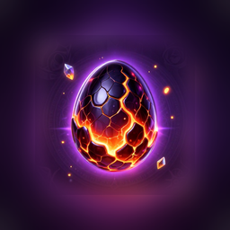

# Crystal Clutch

**A match-3 puzzle game where every win hatches a dragon.**


[**⬇ Download the APK**](https://github.com/0Alduin0/crystal-clutch/releases/latest)

 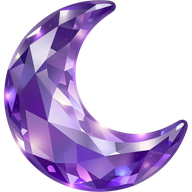 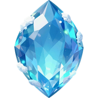 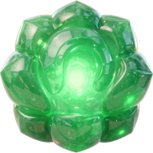

</div>

<!-- Gameplay GIF goes here -->

Crystal Clutch is a complete mobile match-3 game: **100 levels**, special crystals and combos, four obstacle types, a power-up shop, lives, daily gifts, an online leaderboard, and a 3D dragon that grows from an egg to an elder as you win.

The part I'm proudest of is not visible in the game: **none of the 100 levels were placed by hand.** They were generated by a headless copy of the game rules, played thousands of times by a bot that tries to play like a person, and tuned until each one hit its target difficulty. See [Level Lab](#level-lab-how-the-100-levels-were-made).

---

## Gameplay

Swap crystals to make lines of three or more. The goal of every level is the same: **clear all the obstacles on the board before you run out of moves.** Each win pays gold for every move you had left and one dragon egg.

### Special crystals

| | Made by | Effect |
|:-:|---|---|
| 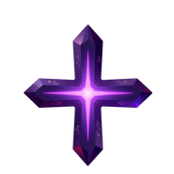 | 4 in a row | **4-Way:** clears its whole row and column |
| 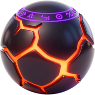 | L or T shape | **Bomb:** blasts the area around it |
| 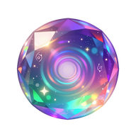 | 5 in a row | **Multicolor:** clears every crystal of one color |

Swapping two specials into each other combines them. Multicolor paired with another special turns every crystal of one color into that special and fires them all.

### Obstacles

| | Obstacle | Behavior |
|:-:|---|---|
| 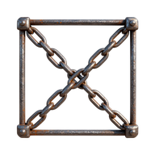 | **Chains** | A crystal is locked inside but still playable. One hit breaks them |
| 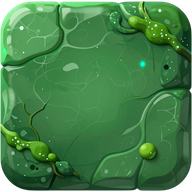 | **Jelly** | Fills the cell and stops falling crystals. When hit, it turns into chains |
| 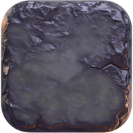 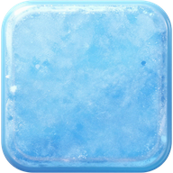 | **Lava / Ice block** | Takes 3–5 hits and cracks with every blast next to it |

### Power-ups (bought with gold)

| | Power-up | Effect |
|:-:|---|---|
| 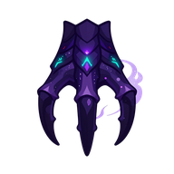 | **Dragon Claw** | Smash any single cell |
| 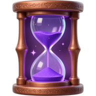 | **Hourglass** | +5 moves |
| 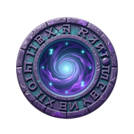 | **Rune Circle** | Reshuffle the board |
| 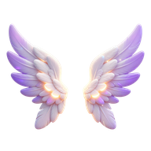 | **Wing of Salvation** | Turn any crystal into a Multicolor |

A targeted power-up is only used up when it is actually applied. If you back out, you keep it.

### Around the board

- **Dragon Nest.** A separate 3D scene where eggs are fed to your dragon. It grows through 7 stages, from egg to elder.
- **Lives:** 5 hearts, and a new one every 30 minutes.
- **Gold economy.** A daily gift of random power-ups, a shop with bulk-discount packs, and the option to spend gold for extra moves when you run out.
- **Leaderboard.** Built on Unity Gaming Services with anonymous sign-in. Every network call fails soft, so the game never breaks when you're offline.
- **Feel:** a hint after 5 idle seconds, native haptics on Android and iOS, and pacing tuned to feel like modern match-3 games.

---

## Level Lab: how the 100 levels were made

Making 100 good levels by hand is slow, and "good" is hard to judge by eye. So the levels are produced by a pipeline that lives in the editor (`Assets/Scripts/Editor/LevelLab/`).

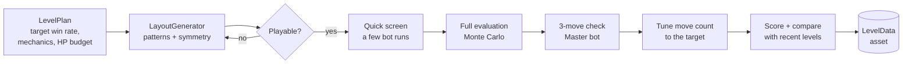

| Piece | What it does |
|---|---|
| **LabBoard** | A copy of `Board.cs`'s rules with no Unity and no animation, so it plays thousands of moves per second. Each method names the `Board` method it mirrors, so the two stay in sync. |
| **LabBot** | Plays like a person, not a solver. It scores every legal swap on a copy of the board without knowing which crystals will fall next, then picks a move. There are three skill levels: *Master* always takes the best move, *Average* picks by softmax, and *Novice* plays about half its moves without thinking. |
| **LabAnalysis** | Monte Carlo runs across all CPU cores. It records the win rate at every move count, so the move limit can be tuned afterwards without replaying. |
| **LayoutGenerator** | Builds obstacle layouts from a pattern library (frames, diamonds, shelves...) with mirror or rotational symmetry. It rejects layouts that cut off the crystal supply or leave dead pockets. |
| **LevelGenerator** | Screens candidates quickly, fully evaluates the best ones, sets the move count, and scores the result. It also rejects layouts too similar to recent levels. Generation runs on a worker thread. |

### The rules the generator plays by

**A sawtooth difficulty curve.** Every 5th level is hard, and the one after it is a breather. Targets are win rates for the *Average* bot:

| Levels | Normal | Hard | Breather |
|---|:-:|:-:|:-:|
| 1–10 | 88% | 70% | 95% |
| 11–30 | 78% | 55% | 92% |
| 31–100 | 70% | 45% | 90% |

**No 3-move wins.** A good player must not be able to clear a level in 3 moves or fewer. The *Master* bot is allowed to do it at most 2% of the time. The generator uses 1.5% as its cutoff, because measurement noise is about ±1%. A level that passed at just under 2% measured 2.7% when re-checked on its own.

**Luck is controlled, not removed.** Early tests showed that a bot making *random* moves won 68–100% of its games on the existing levels, because new crystals kept falling into ready-made matches. Now a per-level `refillLuck` sets how many new crystals are fully random. The rest are chosen so they don't land in an instant match. Chains still happen, but they come from the board shifting, not from lucky drops. With this change, the random bot's win rate fell to 9–40%.

**Mechanics arrive on a schedule.** Jelly appears from level 1, lava blocks at 21, block clusters at 35 and ice at 41. From level 50 on, the block theme alternates every 10 levels, and hard levels bring 4–5 hit blocks.

<picture>
  <source media="(prefers-color-scheme: dark)" srcset="docs/difficulty-curve-dark.png">
  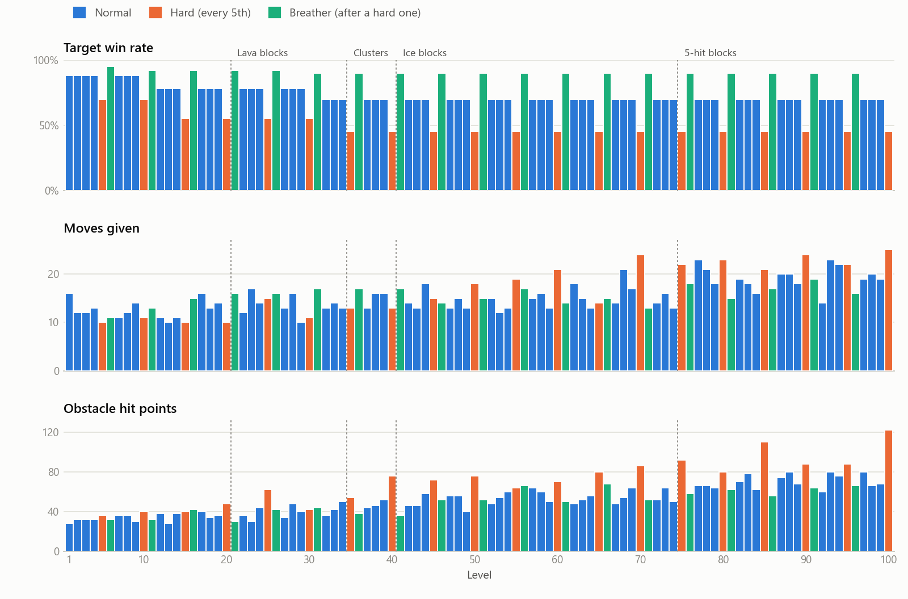
</picture>

The chart is built from the level assets in this repo. Move limits grow from about 12 per level (levels 1–20) to about 19 (levels 81–100). The obstacle hit-point budget roughly doubles over the same span. When every level was re-measured independently, the average deviation from its target was **+0.2 percentage points**.

---

## Engineering notes

- **Pooling instead of Instantiate/Destroy.** Crystals and lightning effects are recycled to avoid GC spikes on mobile.
- **2D physics simulation is off.** Colliders are only used for touch queries, so the physics world never re-simulates 64 crystals that tweens are moving.
- **Mobile performance:** 60 FPS target, Android frame pacing, incremental GC and IL2CPP optimized for speed. A build-prep menu applies these settings, so they can't drift.
- **Profiling on device.** Development builds show an FPS overlay that also reports the *worst* frame of each second, so a single stutter can't hide inside a good average.
- **Build safety.** `Match3 → Build'e Hazırla` wipes editor saves and can stamp a build to reset a test phone's save once. A pre-build check asks for confirmation before a stamped build goes out.
- **Designer tools.** Levels have a clickable obstacle-grid inspector, and the Nest scene can be rebuilt with one menu command.

```
Assets/Scripts/
├── Board.cs, Crystal.cs, ObstacleGrid.cs …   core match-3 rules and board
├── GameManager.cs, LevelData.cs, LevelSet.cs  level flow and data
├── PowerUpController.cs, PowerUpEffect.cs     shop power-ups on the board
├── SaveSystem.cs                              all persistent state
├── LeaderboardService.cs                      the only file that knows about UGS
├── NestUI.cs, DragonView.cs, DragonDefinition.cs   Dragon Nest
├── HapticManager.cs, AppPerformance.cs, FpsOverlay.cs
└── Editor/
    ├── LevelLab/          simulator, bot, analysis, generator
    ├── LevelDataEditor.cs
    ├── BuildPrep.cs
    └── NestSetup.cs
```

> Code comments and in-game text are in Turkish.

---

## Opening the project

Requires **Unity 6000.3.21f1**.

Some third-party content can't be redistributed, so it is not in this repo:

| Missing | How to get it |
|---|---|
| DOTween | Free on the Asset Store. Import it, then run *Tools → Demigiant → DOTween Utility Panel → Setup* |
| UI packs (Simasart, craftpix) | Some UI sprites will show as missing |
| Sound effects, source font file | Not included |

The code compiles once DOTween is in. To just play the game, grab the [APK](https://github.com/0Alduin0/crystal-clutch/releases/latest).

The leaderboard needs the project linked to your own Unity Cloud project, with a leaderboard set to *descending / keep best*. Without it, the game still runs normally.

---

## Credits

- **Tweening:** [DOTween](https://dotween.demigiant.com/) by Demigiant
- **UI packs:** Simasart (Unity Asset Store), [craftpix.net](https://craftpix.net/)
- **2D art:** generated with ComfyUI (Z-Image Turbo), cleaned up with Photoroom
- **3D dragons:** generated with [Tripo AI](https://www.tripo3d.ai/), prepared in Blender
- **Music:** generated with [Suno](https://suno.com/)
- **Font:** Stormfaze

Design, code and levels by [@0Alduin0](https://github.com/0Alduin0).
